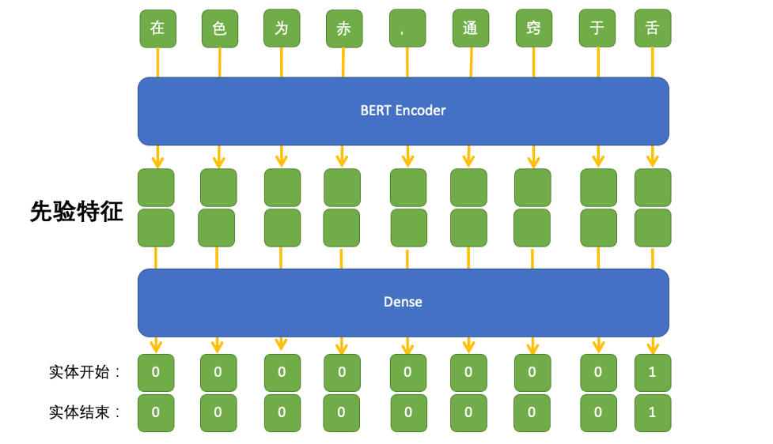

<div align="center">


# TCM-NER: Named Entity Recognition for Ancient Chinese Medicine Books via GuwenBERT and Pointer Networks

**A High-Performance Named Entity Recognition Framework Tailored for Ancient Traditional Chinese Medicine (TCM) Literature**

[](https://www.python.org/)
[](https://pytorch.org/)
[](https://huggingface.co/ethanyt/guwenbert-base)
[]()
[]()
[](LICENSE)

[English Documentation](README_EN.md) | [中文说明文档](README.md)

</div>

---

## 📖 Introduction

Ancient Traditional Chinese Medicine (TCM) literature represents thousands of years of accumulated clinical experience, therapeutic methodologies, and theoretical knowledge. With advancements in Digital Humanities and Medical Informatics, extracting structured entities and relations from unstructured historical medical cases has become a critical foundation for constructing TCM Knowledge Graphs and developing intelligent diagnostic assistance systems.

However, historical TCM texts present distinctive natural language processing challenges: **concise classical Chinese grammar, semantic divergence between ancient and modern terms, lengthy entity spans, overlapping/nested entities, and strong topical discourse cohesion**. Traditional sequence labeling approaches based on BIO/BMES tag schemes and Conditional Random Fields (CRF) often suffer from decoding bottlenecks when handling long spans and ambiguous boundaries.

To address these challenges, **TCM-NER** adopts **GuwenBERT** (a pre-trained language model specialized in classical Chinese) as the deep semantic encoder and integrates a **bidirectional Pointer Network** architecture with a "half-pointer, half-labeling" paradigm:
1. **Semantic Representation**: Employs GuwenBERT to deeply capture grammatical and contextual semantics of classical Chinese;
2. **Boundary Decoupling**: Deconstructs entity extraction into parallel boundary classification tasks, utilizing dual prediction heads to independently score entity start positions (Start Pointer) and end positions (End Pointer);
3. **Multi-label & Overlapping Support**: Replaces standard multi-class Softmax with independent Sigmoid activation functions, natively handling overlapping, nested, and polysemous entity spans.

---

## ✨ Key Features

- 🏛️ **Classical Chinese Pre-trained Encoder**: Powered by `ethanyt/guwenbert-base`, pretrained on extensive classical Chinese corpora, providing superior representations for ancient characters, loan words, and TCM terminology.
- 🎯 **Decoupled Pointer Boundary Decoding**: Eliminates strong constraints imposed by BIO transition matrices, framing span boundary detection as independent start/end binary classifications to prevent entity boundary truncation.
- 🔀 **Overlapping & Nested Entity Extraction**: Employs multi-label Sigmoid scoring to natively extract overlapping or nested entities across identical text segments.
- 📚 **Authoritative Ancient Medical Corpus**: Curated from 20 representative ancient TCM medical case books (e.g., *Zhu Danxi Medical Cases*, *Ye Tianshi Medical Cases*, *Xue Lizhai Medical Cases*), annotating high-value categories including Drugs, Formulas, Body Parts, and Patient Age/Symptoms.
- 🛠️ **End-to-End Pipeline**: Includes full tooling for Doccano format conversion, dynamic batch padding, distributed training (DDP), and automated Bad Case error analysis.

---

## 📊 Dataset & Annotation Schema

### 1. Entity Category Schema

The annotated corpus focuses on fundamental components of TCM diagnosis and therapy:

| Entity Category | Tag | Description | Ancient Text Examples |
| :--- | :--- | :--- | :--- |
| **Herbal Medicine** | `DRUG` | Single herbs, processed ingredients, botanical substances | 白术 (Atractylodes), 黄连 (Coptis), 陈皮 (Tangerine peel), 生姜 (Ginger) |
| **Prescription / Formula** | `FORMULA` | Classical prescriptions, compound formulas, empirical remedies | 平胃散 (Pingwei Powder), 牛黄清心凉膈丸, 活幼方 |
| **Body Part / Organ** | `BODY` | Zang-Fu organs, meridians, sensory orifices, anatomical regions | 心 (Heart), 舌 (Tongue), 胃肠 (Gastrointestinal), 肺 (Lung), 两颊 (Cheeks) |
| **Age / Syndrome** | `AGE` | Patient age indicators, temporal traits, or syndrome markers | 七十 (Seventy years old), 小儿 (Infant), 壮年 (Prime age) |

### 2. Annotation Examples

The corpus was annotated and verified using the Doccano platform:

- **Body Part & Anatomical Feature Annotation**:  
    
  *Example: "心者，在天为热，在地为火，在人为心【身体部位】，在时为夏……通窍于舌【身体部位】。"*

- **Prescription & Clinical Intervention Annotation**:  
    
  *Example: "诸药不愈，用活幼方中牛黄清心凉膈丸【方剂】，敷服而愈。"*

---

## 🔍 Domain Characteristics of Ancient TCM Texts

During corpus construction and empirical analysis, two primary linguistic challenges emerged:

1. **Topical Discourse Cohesion**  
   Ancient clinical records are typically organized around specific case presentations or syndromes. A practitioner typically begins by detailing patient complaints, signs, and pulse appearances, proceeds to syndrome differentiation and pathological analysis, and concludes with treatment principles and customized prescriptions. Within local passages, symptom terms, disease concepts, and herbal remedies co-occur in dense, semantically cohesive networks.

2. **Domain Semantic Discrepancy Between TCM and Modern Medicine**  
   TCM terminology relies on holistic analogies and dynamic pathology, differing profoundly from modern biomedical concepts:
   - **Disease ("病") vs. Syndrome ("证")**: In modern medicine, a disease denotes a distinct pathological entity with specific etiology. In TCM, "disease" covers the entire progression trajectory, while "syndrome" captures the immediate imbalance of Yin, Yang, Qi, and Blood at a particular stage.
   - **Multi-Syndrome Complexity**: For instance, under the category of malaria ("疟疾"), TCM differentiates between regular malaria, warm malaria, cold malaria, pestilential malaria (cold/hot), exhaustion malaria, and chronic splenic malaria, each bearing disparate etiologies. Accurately resolving entities requires strong contextual reasoning rather than surface keyword matching.

---

## 🏗️ Model Architecture

The overall model consists of a **Classical Chinese Pre-trained Encoder** and a **Dual Pointer Decoding Layer**:



### 1. Encoder (GuwenBERT)
Given an input character sequence $X = (x_1, x_2, \dots, x_n)$, a multi-layer bidirectional Transformer pre-trained on classical Chinese generates token-level hidden representations:
$$H = \text{GuwenBERT}(X) \in \mathbb{R}^{n \times d}$$
where $d = 768$ denotes hidden layer dimensionality.

### 2. Dual Pointer Boundary Layer
To identify entity boundaries and accommodate long or nested mentions, two parallel linear projection heads with Sigmoid activations are applied:
- **Start Boundary Predictor (Start Pointer)**:
  $$P_{start} = \sigma(W_{start} H + b_{start}) \in \mathbb{R}^{n \times 1}$$
- **End Boundary Predictor (End Pointer)**:
  $$P_{end} = \sigma(W_{end} H + b_{end}) \in \mathbb{R}^{n \times 1}$$

### 3. Span Decoding Strategy
During inference, preset confidence thresholds (e.g., $P_{start} \ge 0.7, P_{end} \ge 0.6$) filter candidate start index set $\mathcal{S}$ and end index set $\mathcal{E}$. For each start index $i \in \mathcal{S}$, valid end indices $j \in \mathcal{E}$ ($j \ge i$) are matched to form predicted entity spans $[i, j]$.

### 4. Loss Function
The model optimizes joint multi-label Binary Cross-Entropy (BCE) loss across both boundary prediction heads:
$$\mathcal{L} = \frac{1}{2} \left( \mathcal{L}_{BCE}(P_{start}, Y_{start}) + \mathcal{L}_{BCE}(P_{end}, Y_{end}) \right)$$

---

## 📁 Repository Structure

```text
.
├── DataFormat/                  # Data preprocessing and conversion utilities
│   ├── Format.py                # Text normalization script
│   ├── NER_Format.py            # Converts Doccano annotations to standard training format
│   └── Split_File.py            # Dataset split tool
├── data/                        # Dataset storage
│   └── 4-3.zip                  # Compressed original annotation package
├── img/                         # Diagrams and visual assets
│   ├── Picture1.png             # Body part annotation example
│   ├── Picture2.png             # Formula annotation example
│   ├── Picture3.png             # Pointer network architecture diagram
│   └── loge-1.png               # Project Logo
├── dataloder.py                 # DataLoader with dynamic batch sequence padding
├── main.py                      # Model definition, distributed training, and evaluation
├── test_Modules.py              # Auxiliary module tests
├── test_generator.py            # Data generator pipeline verification
├── Example of data labeling.txt # Sample dataset with entity span annotations
├── README.md                    # Chinese documentation (中文说明文档)
└── README_EN.md                 # English documentation
```

---

## 🚀 Quick Start

### 1. Prerequisites

Python 3.8+ and a CUDA-compatible GPU environment are recommended:

```bash
git clone https://github.com/KuoChing-cmd/ZhongYi-NER2.git
cd ZhongYi-NER2
pip install torch torchvision transformers numpy tqdm
```

### 2. Pretrained Weights Setup

The model uses `ethanyt/guwenbert-base`. You can clone the model repository locally to `./guwenbert-base/` or load it directly via HuggingFace Hub:

```bash
# Clone weights from HuggingFace Hub (optional)
git lfs install
git clone https://huggingface.co/ethanyt/guwenbert-base
```

### 3. Data Format & Preprocessing

The standard training input format is a JSON array containing `text` and `ner` lists (see [`Example of data labeling.txt`](Example%20of%20data%20labeling.txt)):

```json
[
  {
    "text": "族叔祖年七十，禀甚壮，形甚瘦。夏末患泄利至深秋，百方不应……以荣萸、陈皮、青葱、鹿首根、生姜煎浓汤，和以砂糖，饮一碗许……又与平胃散加白术、黄连，旬日而安。",
    "ner": [
      "七十",
      "胃肠",
      "肺",
      "大肠",
      "陈皮",
      "青葱",
      "生姜",
      "砂糖",
      "平胃散",
      "白术",
      "黄连"
    ]
  }
]
```

To convert raw Doccano exports into this format, run:

```bash
python DataFormat/NER_Format.py
```

### 4. Training

To start training:

```bash
python main.py
```

The script utilizes distributed training components, periodically evaluates performance on the validation set, and preserves the best checkpoint as `NER_best.pth`.

### 5. Inference Example

Once training is complete, entity extraction can be executed as follows:

```python
import torch
import numpy as np
from transformers import BertTokenizer

tokenizer = BertTokenizer.from_pretrained("ethanyt/guwenbert-base")
device = torch.device("cuda" if torch.cuda.is_available() else "cpu")
model = torch.load("NER_best.pth", map_location=device)
model.eval()

def extract_entities(text: str, start_threshold=0.7, end_threshold=0.6):
    token_ids = tokenizer.encode(text)
    inputs = torch.as_tensor([token_ids], device=device)
    
    with torch.no_grad():
        pn1, pn2 = model(inputs)
        pn1 = pn1.squeeze(0).squeeze(-1).cpu().numpy()
        pn2 = pn2.squeeze(0).squeeze(-1).cpu().numpy()
        
    start_indices = np.where(pn1 > start_threshold)[0]
    end_indices = np.where(pn2 > end_threshold)[0]
    
    entities = set()
    for s in start_indices:
        e_candidates = end_indices[end_indices >= s]
        for e in e_candidates:
            span = text[s:e]
            if span:
                entities.add(span)
    return entities

# Test sample
sample_text = "心者，在天为热，在地为火，在人为心，在时为夏，在方为志，在色为赤，通窍于舌。"
print("Extracted entities:", extract_entities(sample_text))
```

---

## 📈 Evaluation & Error Analysis

The evaluation routine computes standard sequence extraction metrics (**Precision**, **Recall**, and **F1-Score**):

$$Precision = \frac{|R \cap T|}{|R|}, \quad Recall = \frac{|R \cap T|}{|T|}, \quad F1 = \frac{2 \times Precision \times Recall}{Precision + Recall}$$

where $R$ is the set of predicted entity mentions and $T$ is the ground-truth set. Detailed diagnostics are saved to `./data/eval.csv` containing:
- `text`: Source historical medical text
- `ner_list`: Ground-truth annotated entities
- `ner_list_pred`: Model-predicted entities
- `new`: False positives / candidate discoveries omitted from initial annotations
- `lack`: False negatives / missed entities for error analysis

---

## ⚖️ Disclaimer

1. The performance figures presented in this repository reflect outcomes on specific historical corpora and hyperparameter configurations and do not guarantee identical generalization across all ancient texts.
2. Experimental results may fluctuate due to random seeds, hardware architectures, and dependency versions.
3. All code, data processing pipelines, and model implementations are intended **strictly for academic research, digital humanities exploration, and NLP technical exchange**. They **must not be used as clinical diagnostic criteria or medical advice**.
4. Users must adhere to open-source licenses. The development team accepts no liability for direct or indirect consequences arising from the use of this project.

---

## 📄 License

This project is licensed under the [MIT License](LICENSE).